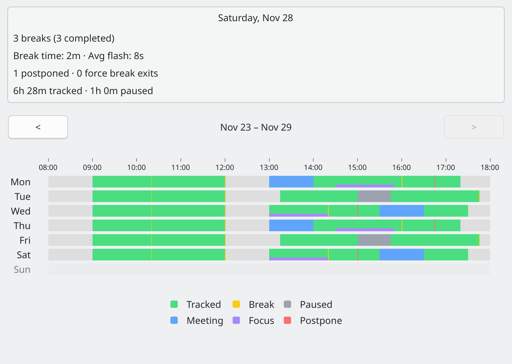
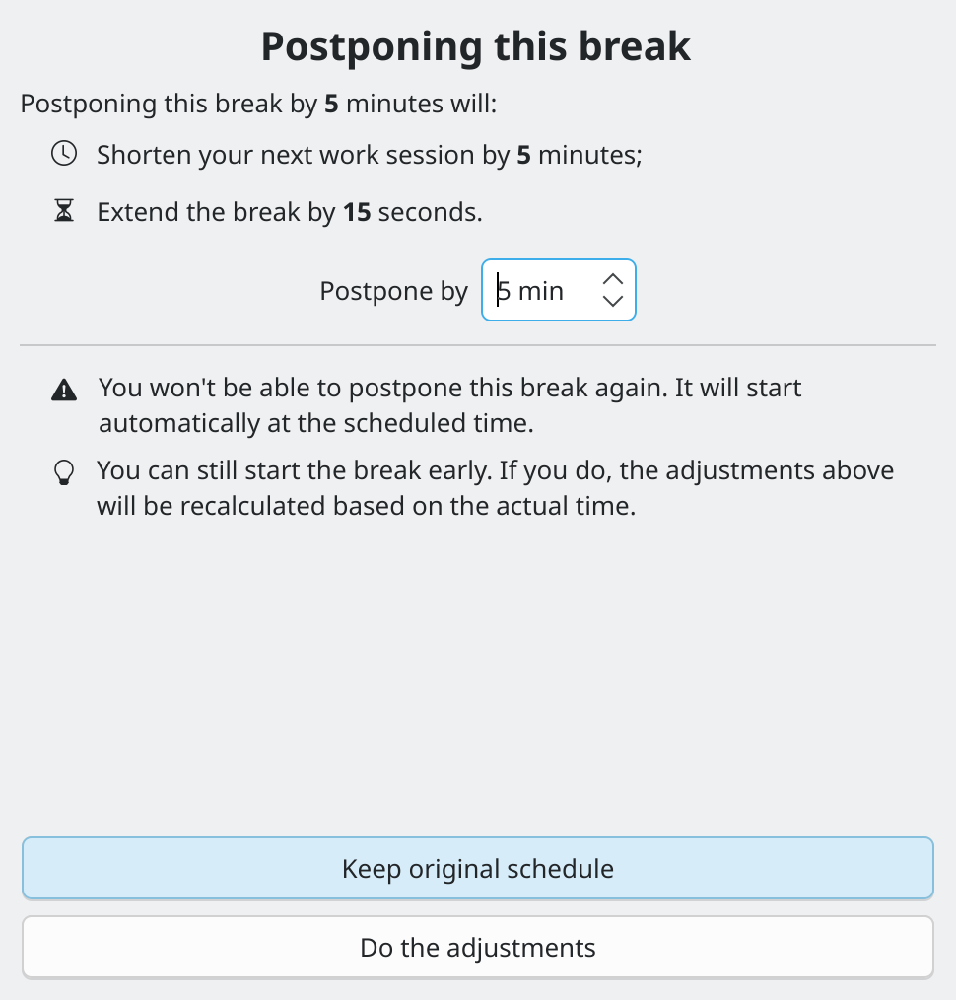
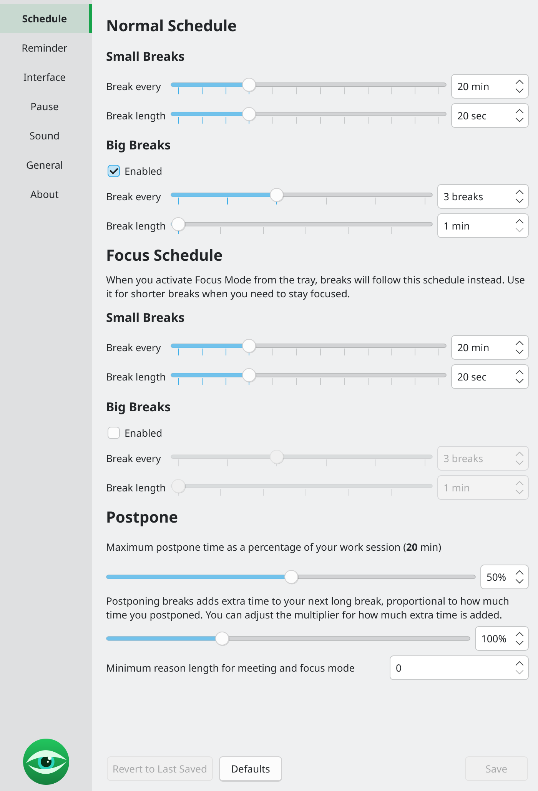
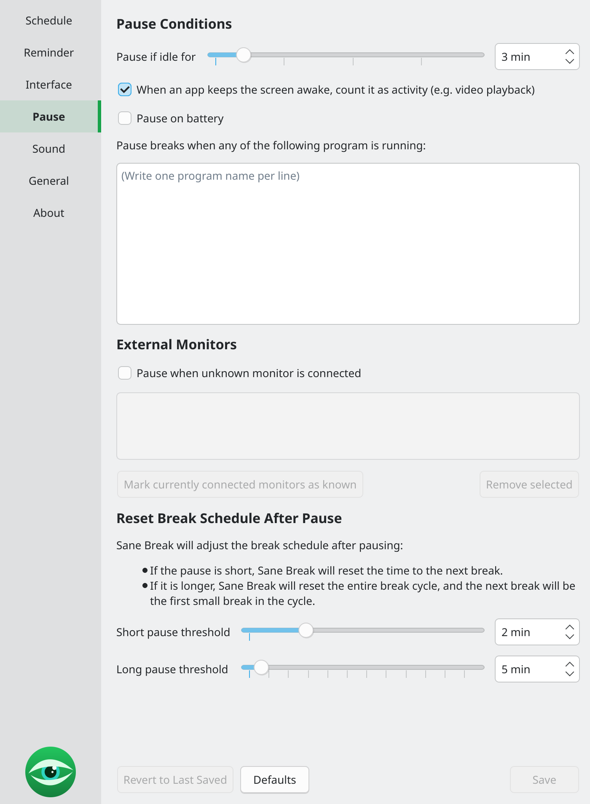

  

<h1 align="center">Sane Break</h1>

  
  
  
  
  

  A gentle, cross-platform break reminder designed to help you take meaningful rests without disrupting your workflow.

  <a href="https://allanchain.github.io/sane-break/"><b>Website &amp; Interactive Demo</b></a>
  ·
  <a href="https://allanchain.github.io/sane-break/installation"><b>Installation</b></a>
  ·
  <a href="https://allanchain.github.io/sane-break/breaks-and-schedule"><b>User Guide</b></a>
  ·
  <a href="https://allanchain.github.io/sane-break/cli"><b>CLI &amp; Hooks</b></a>

  
  &nbsp;
  
  &nbsp;
  

## Why Sane Break?

Traditional break reminders either block your screen mid-sentence or put a prominent Skip button right on the reminder window. Accepting an abrupt interruption is jarring, so clicking Skip or Postpone quickly turns into muscle memory, and hours pass without a single rest.

Sane Break is inspired by [RSIBreak](https://apps.kde.org/rsibreak/) and [WorkRave](https://workrave.org/) and uses a two-phase reminder system so you control the exact moment a break begins (read more in [No break reminder works (for me)](https://allanchain.github.io/blog/post/sane-break-intro/)).

- **Phase 1 (Flashing Prompt)** displays a small, click-through banner at the top of the screen while you finish typing your current thought.
- **Phase 2 (Full-Screen Break)** expands the reminder to full screen as soon as you stop keyboard and mouse input for 2 seconds (or after a configurable timeout if you ignore the prompt). During the initial grace period, resuming input shrinks the window right back to the flashing prompt.
- **Intentional Friction** keeps skip and postpone buttons off the break prompt so dismissals never become a reflex.

An [interactive two-phase break demo](https://allanchain.github.io/sane-break/) is available on the documentation site.

## Key Features

- **[Two-Phase Breaks and Pre-Break Warnings](https://allanchain.github.io/sane-break/breaks-and-schedule)** combine alternating small and big break cycles with an optional floating heads-up countdown pill and tray icon indicator.
- **[Focus Mode, Meeting Mode, and Mindful Postponing](https://allanchain.github.io/sane-break/modes-and-postponing)** adapt breaks around Pomodoro-style deep work, calls, and urgent deadlines. Postponing is limited to once per break and balances the delay by extending the upcoming rest and shortening the next work session.
- **[Context-Aware Automatic Pause](https://allanchain.github.io/sane-break/automatic-pause)** pauses the schedule during user idle, screen lock, system sleep, battery power, monitored applications, or connections to unrecognized external monitors and projectors, and resets the break cycle after longer absences.
- **[Local-Only Activity Timeline and Customization](https://allanchain.github.io/sane-break/customization)** plot daily breaks, focus sessions, meetings, and pauses from a local SQLite database with zero network requests, alongside independent small and big break themes and sound bells.
- **[CLI Control and Lifecycle Hook Scripts](https://allanchain.github.io/sane-break/cli)** output JSON status for status bars like Waybar, trigger modes from keyboard shortcuts, and run custom scripts or dynamic wallpaper overrides on break events.

  
  

  
  

## Installation

- **Windows** packages are available on the [Microsoft Store](https://apps.microsoft.com/detail/9n1c3x5dwhxx?referrer=appbadge&mode=direct) and as `sane-break-windows.zip` on the [GitHub releases page](https://github.com/AllanChain/sane-break/releases).
- **macOS** packages can be installed via Homebrew (`brew install allanchain/tap/sane-break`), the [Mac App Store](https://apps.apple.com/us/app/sane-break/id6740942634), or `.dmg` installers on the [GitHub releases page](https://github.com/AllanChain/sane-break/releases).
- **Linux** packages are available on [Flathub](https://flathub.org/apps/io.github.AllanChain.sane-break) (`flatpak install flathub io.github.AllanChain.sane-break`), the AUR (`yay -S sane-break`), [Fedora Copr](https://copr.fedorainfracloud.org/coprs/allanchain/sane-break/) (`sudo dnf copr enable allanchain/sane-break && sudo dnf install sane-break`), and as `.deb` and AppImage binaries on the [GitHub releases page](https://github.com/AllanChain/sane-break/releases).

The [Installation Guide](https://allanchain.github.io/sane-break/installation) covers GNOME Wayland Shell extension setup, i3wm window rules, Linux Flatpak autostart, Windows portable mode, and building from source with CMake and Qt 6.

## Contributing

Translations are hosted on [Weblate](https://hosted.weblate.org/engage/sane-break/).

