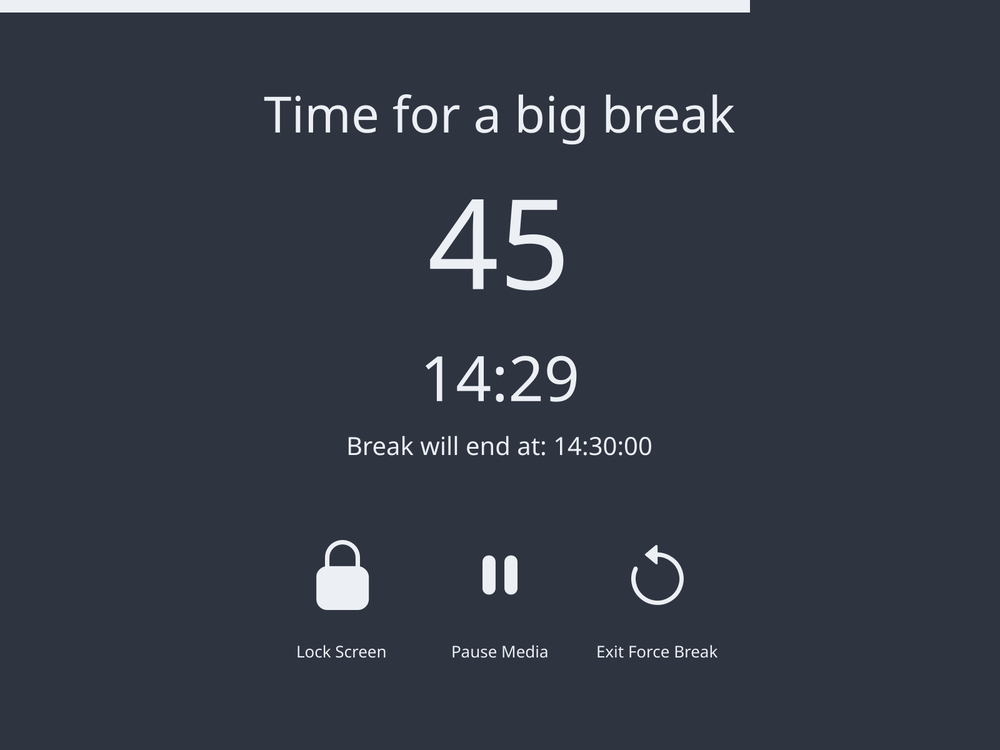

# Breaks and Schedules

Sane Break organizes breaks into cycles of short rests (**Small Breaks**) and longer recovery rests (**Big Breaks**), delivered through a two-phase reminder window.

## Small and Big Break Cycles

Under **Preferences -> Schedule -> Normal Schedule**, Sane Break tracks two break types.

- **Small Breaks** happen after a regular work interval (by default, a **20-second** break every **20 minutes**).
- **Big Breaks** replace every Nth small break with a longer rest (by default, every **3rd break** is a **1-minute** big break).

With the default schedule (small break every 20 minutes, big break every 3 breaks), a complete cycle runs through three intervals.

1. 20 minutes of work -> Small Break (20 seconds)
2. 20 minutes of work -> Small Break (20 seconds)
3. 20 minutes of work -> Big Break (1 minute)

Big breaks can be turned off if you prefer uniform intervals.

## Pre-Break Warnings

Before a break starts, Sane Break can give you an early heads-up under **Preferences -> Reminder** so you can wrap up your current line of thought.

- **Flash tray icon before break** (default **30 seconds**) blinks the system tray icon during the final seconds of a work session. Setting it to `0` disables tray flashing.
- **Show heads-up before break** (default **30 seconds**) displays a small floating pill at the top center of the screen showing the remaining time before the break. Clicking the pill starts the break immediately. Setting it to `0` disables the heads-up pill.

## The Two-Phase Break Flow

When the work timer reaches zero, Sane Break starts the break. Instead of blocking the screen right away, it progresses through two phases controlled under **Preferences -> Reminder**.

### Phase 1 (Flashing Prompt)

A small, non-intrusive banner appears at the top of the screen and flashes gently.

- The window does not steal keyboard focus, and on Wayland, macOS, and Windows it allows mouse clicks to pass right through to the windows underneath.
- You can finish typing a sentence, save a file, or reach a natural stopping point.
- As soon as you stop keyboard and mouse input for **2 seconds**, Sane Break expands to the full-screen break.
- If you keep working continuously for the full **Show break prompt for** duration (default **30 seconds**), Sane Break enters **Force Break** mode and expands to full screen automatically.

### Phase 2 (Full-Screen Break)

Once the window expands to full screen, the break countdown ticks down.

- **Before the break locks in** applies when the window expanded because you paused input. During the first **Confirm break after** seconds (default **30 seconds**), moving the mouse or pressing a key resets the break countdown and shrinks the overlay back to the flashing prompt so you can finish what you forgot.
- **Locked full screen** engages once you have stayed idle for the **Confirm break after** threshold (or immediately if the flashing prompt timer ran out and triggered a Force Break). The full-screen window then stays in place until the countdown finishes.

## Full-Screen Break Controls

When the full-screen break locks in place, action buttons appear at the bottom of the screen (when **Buttons** is enabled in **Preferences -> Interface**).

- **Lock Screen** immediately locks your OS session.
- **Pause Media** pauses active audio or video playback across the system.
- **Exit Force Break** shrinks the locked full-screen overlay back to the flashing prompt and restarts the prompt timer. To prevent endless bypassing, this button is limited by **Max number of force break exits** (default **2 times** per break).

If a big break starts when you only have time for a brief rest, the tray menu provides **Take a small break instead** during the break. Sane Break converts the current break into a small break and keeps the big break queued for the next interval.

## Post-Break Window Closing and Auto Screen Lock

When the break countdown reaches zero, Sane Break checks whether you are back at the computer.

- If you are actively using the computer, the break window closes and the next work session starts immediately.
- If you are still away from the computer, Sane Break waits until you return before starting the next work timer.
  - When **Close windows right after small/big break ends** is enabled (the default), the break overlay closes as soon as the countdown finishes.
  - When unchecked, the full-screen overlay stays on screen at `0` with action buttons hidden (and displays `Break has ended` if **Time when break ends** is enabled) until you move the mouse or press a key.
  - If you remain away after a small break for at least the extra length of a big break, Sane Break counts the extended absence as a full recovery rest and resets the big-break cycle counter.

**Automatic screen lock after break start** under **Preferences -> General** (Disabled, 30 sec, 1 min, 2 min, or 5 min) starts a timer when the break enters full-screen mode and locks your session if no input is detected before the timer expires.

## Tray Icon and Quick Actions

The system tray icon displays your current mode and progress at a glance.

- **Green progress ring** shows the normal schedule, emptying as the next break approaches.
- **Yellow corner dot** indicates that the upcoming break is a **Big Break**.
- **Purple progress ring** indicates that [Focus Mode](/modes-and-postponing#focus-mode) is active.
- **Blue progress ring** indicates that [Meeting Mode](/modes-and-postponing#meeting-and-presentation-mode) is active.
- **Pause icon** appears while breaks are paused, during an active break, or while a postponed countdown exceeds a normal work interval.

The tray menu provides **Next break after...** and **Next big break after...** to start a break early. Enabling **Start next break after middle clicking on tray icon** (Linux) or **double clicking on tray icon** (Windows) under **Preferences -> General** triggers the next break directly from the tray icon.
