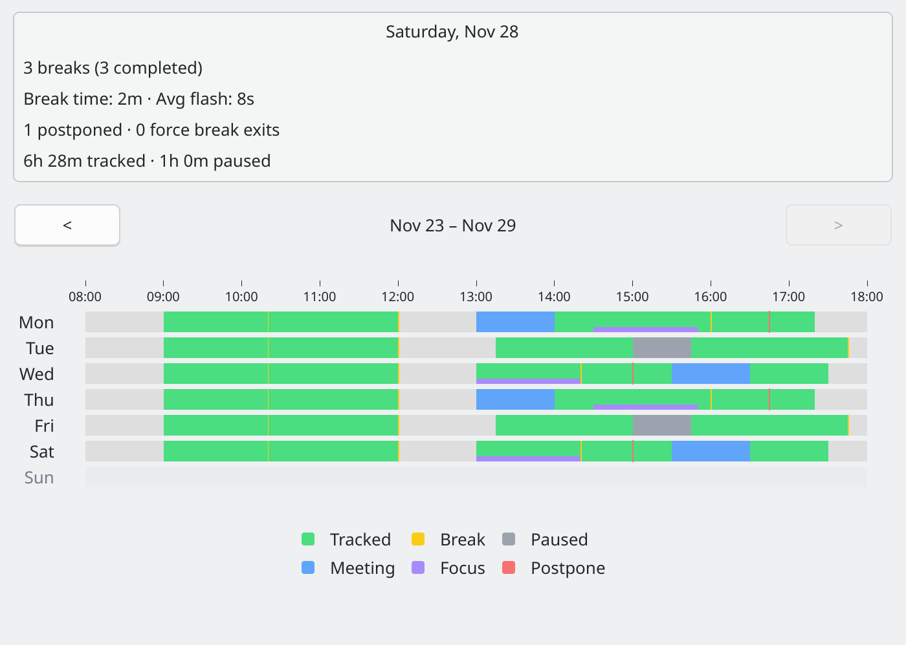

# Customization and Statistics

Sane Break lets you tailor the appearance and audio of small and big breaks independently, inspect your daily rest habits, and manage your local configuration files.

## Visual Customization

Under **Preferences -> Interface**, you can configure the look and feel of the break windows.

- **Flash speed** (default **120 BPM**) controls how rapidly the Phase 1 prompt pulses. Setting it to `0` produces a solid, non-flashing banner.
- **Break messages** accept one message per line for **Small break messages** and **Big break messages**. When a break expands to full screen, Sane Break picks one line at random from the list.
- **Components to Show** toggles which elements appear on the full-screen overlay for small and big breaks separately.
  - **Progress bar** (also shown in the flashing prompt)
  - **Countdown timer**
  - **Clock** (current time of day)
  - **Time when break ends**
  - **Buttons** (**Lock Screen**, **Pause Media**, and **Exit Force Break**)
- **Color Theme** uses `#AARRGGBB` hex format (alpha, red, green, blue). Separate **Background color**, **Prompt flash** color, and **Background image** files can be configured for small and big breaks, along with shared colors for the **Message** text and **Count down** timer.
- **Preview Break Windows** runs a 2-second flashing prompt and 4-second full-screen preview of your saved small and big break themes.

[Dynamic Break Customization with Hooks](/hooks#dynamic-break-customization-break-customize) covers dynamic per-break overrides such as rotating wallpapers from a folder or fetching quotes from a script.

## Sound Effects

Under **Preferences -> Sound**, you can assign a **Bell before breaks** (played when the break prompt appears) and a **Bell after breaks** (played when the full-screen break completes) for both small and big breaks.

You can select one of the built-in sounds (`chime`, `ding`, `wood`, `bell`) or click **Browse** to import a custom `.mp3`, `.wav`, `.ogg`, `.flac`, or `.m4a` file. Sane Break copies imported audio files and background images into its application data directory so they keep working even if the original file moves.

## Activity and Break Statistics

Selecting **Statistics** from the system tray menu opens the weekly timeline and daily summary window.

### Daily Metrics

Hovering over any day in the timeline (or viewing today by default) displays four summary metrics.

- **Breaks** reports total breaks triggered that day and how many were completed normally.
- **Break time and prompt response** reports total time spent in breaks and your **Avg flash** time (the average number of seconds the Phase 1 prompt flashed before you stopped working and let the break start).
- **Postpones and force exits** reports how many times a break was postponed or exited via **Exit Force Break** that day.
- **Tracked and paused time** compares total active work time tracked in Normal mode against time spent in Paused or Meeting states.

### Weekly Timeline

The timeline visualizes each day's spans across active hours, color-coded by activity (normal work, breaks, meetings, pauses, and focus sessions) along with markers for postpone events. The `<` and `>` buttons navigate across weeks.

## Where Configuration and Data Are Stored

Sane Break displays the exact paths to your active **Configuration file** and **Database file** under **Preferences -> General**.

### Configuration File (`SaneBreak.ini`)

- **Linux and macOS** store preferences in `~/.config/SaneBreak/SaneBreak.ini`.
- **Windows** stores preferences in `%APPDATA%\SaneBreak\SaneBreak.ini`.
- **Portable Mode** activates automatically when a file named `SaneBreak.ini` exists in the same directory as the `sane-break` executable, storing all preferences there instead of the user profile directory.

`SaneBreak.ini` is a plain-text file that can be backed up or edited while Sane Break is closed. In addition to the preferences exposed in the GUI, the `[postpone]` section supports `shrink-next-session-ratio` (default `100`), which controls the percentage of postponed time subtracted from the following work session.

### Statistics Database (`sane-break.db`)

All statistics are stored locally in a SQLite database (`sane-break.db`) inside your platform's standard application data directory.

- **Linux** uses `~/.local/share/SaneBreak/sane-break.db` (or `~/.var/app/io.github.AllanChain.sane-break/data/SaneBreak/sane-break.db` for Flatpak).
- **macOS** uses `~/Library/Application Support/SaneBreak/sane-break.db`.
- **Windows** uses `%APPDATA%\SaneBreak\sane-break.db`.

Sane Break never collects telemetry or makes network requests. Deleting `sane-break.db` while Sane Break is closed resets your statistics history.
