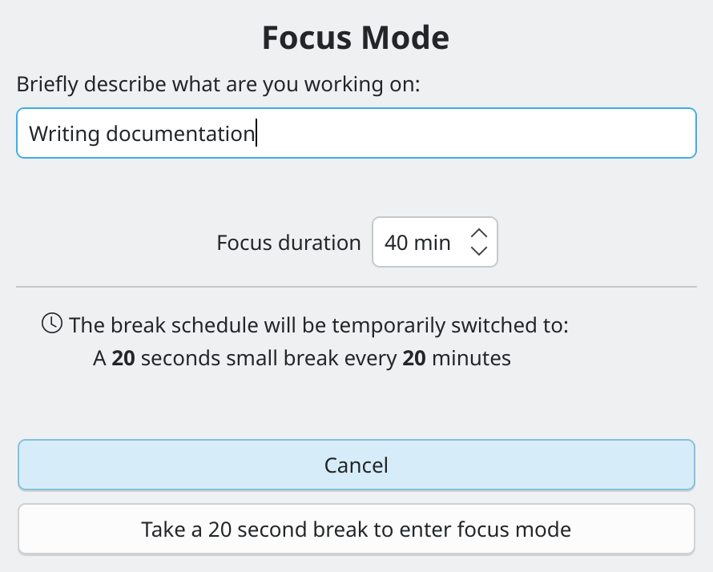
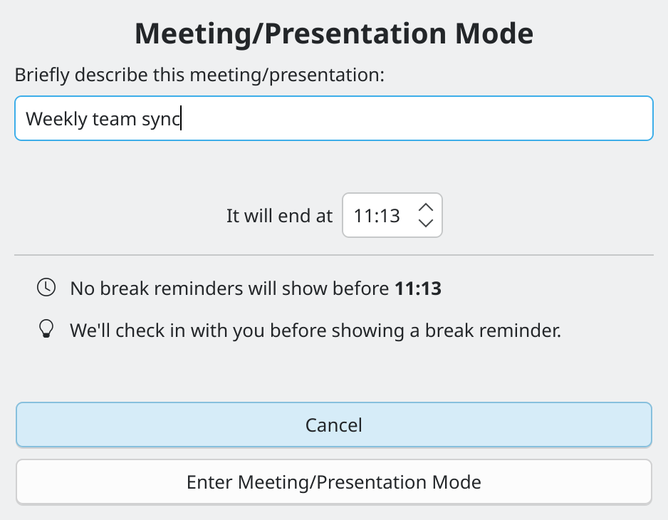
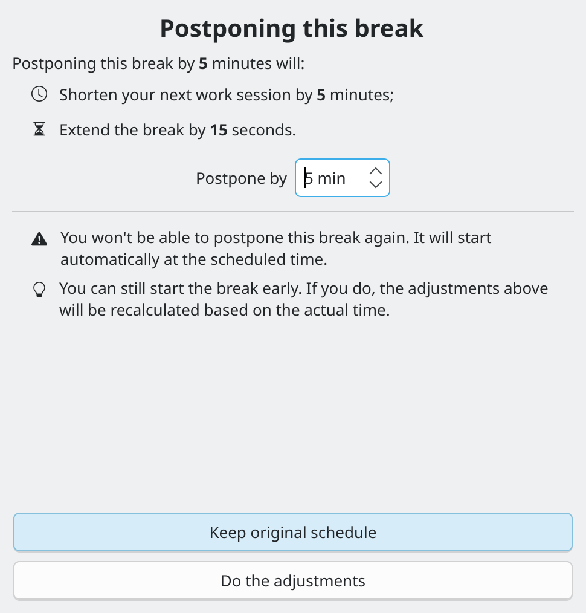

# Focus, Meetings, and Postponing

Instead of offering a single "skip" button on the break overlay, Sane Break provides three structured ways to adapt breaks around deep work, live calls, and urgent deadlines.

## Focus Mode

Focus Mode temporarily switches Sane Break to a separate break schedule configured under **Preferences -> Schedule -> Focus Schedule**. It supports shorter, more frequent micro-breaks or Pomodoro-style blocks during intense work.

### Starting Focus Mode

The **Focus Mode** submenu in the system tray offers preset durations (1x to 4x your focus interval) and **Custom...**.

1. Choose your total focus duration (measured in multiples of the focus work interval) and optionally enter what you are working on.
2. Click **Take a N second break to enter focus mode**.
3. Sane Break starts an immediate full-screen entry break (with the **Exit Force Break** button disabled) so you begin your focus session rested.
4. Once the entry break completes, your focus cycles begin. The tray icon turns purple and shows the completed and total cycles, such as `focus: 18:40 (0/3)` (or `focus: small break 18:40 (0/3)` when big breaks are enabled in the focus schedule).

While Focus Mode is active, postponing is disabled. Focus Mode ends automatically after the final cycle's break finishes, or selecting **End Focus & Break** from the tray menu triggers a closing break and returns to your normal schedule.

## Meeting and Presentation Mode

Meeting Mode suppresses all break reminders until a scheduled end time, making it suitable for video calls, screen sharing, and lectures.

### Starting Meeting Mode

The **Meeting Mode** submenu in the system tray provides **30 min**, **60 min**, **2 hours**, and **Custom...** options.

- In the **Custom...** dialog, choose the time the meeting will end and optionally record a description.
- In the tray menu, **Meeting Mode** is hidden while Focus Mode is active.
- While Meeting Mode is active, the tray icon turns blue and shows the end time and remaining duration. The **Extend Meeting** submenu in the tray adds 15 minutes, 30 minutes, or 1 hour at any time.

### Ending a Meeting

During the final **60 seconds** of Meeting Mode, Sane Break displays a **Meeting Mode Ended** check-in dialog with three choices.

- **Break now** ends Meeting Mode and immediately starts a recovery break (which is promoted to a Big Break if big breaks are enabled).
- **Break in N minutes** ends Meeting Mode and schedules the next break for one full work interval later (with the next break queued as a Big Break).
- **Not yet (extend 30 minutes)** extends Meeting Mode by 30 minutes.

If the 60-second countdown finishes without interaction, Sane Break exits Meeting Mode, queues a Big Break (when big breaks are enabled), and resumes the normal work schedule.

## Mindful Postponing

When a deadline cannot wait, the **Postpone** submenu in the system tray delays the upcoming break. If the flashing break prompt is already on screen, opening the Postpone dialog defers force-break escalation while you choose a time.

To prevent postponing from turning into a habit that erases your rest, Sane Break enforces three rules configured under **Preferences -> Schedule -> Postpone**.

1. **One postpone per break** means that once a break is postponed, it cannot be postponed a second time until that break has been completed.
2. **Maximum postpone limit** caps the postpone slider at a percentage of your normal work session (default **50%**, which is 10 minutes on a 20-minute work interval).
3. **Proportional time trade-offs** balance out the delayed break.
   - **Next work session is shortened** by the amount of time you postponed, keeping your overall break rhythm aligned.
   - **Upcoming break is extended** in proportion to how long you postponed. A slider under **Preferences -> Schedule -> Postpone** adjusts the multiplier for how much extra break time is added (default **100%**).

If you finish your task sooner than expected and start the break early from the tray menu, Sane Break recalculates both adjustments based on the actual time postponed rather than the full planned amount.

While a break is postponed, stepping away briefly does not pause or cancel the postponed countdown. If your computer enters an explicit pause (such as locking the screen or sleeping) that lasts past the end of the postponed break window, Sane Break counts the rest as taken and clears both time trade-offs. Staying away after a postponed break finishes for longer than the **Long pause threshold** (default 5 minutes) also restores the next work session to its full length.

## Reason Prompts

Both Focus Mode and Meeting Mode include a text field to note what you are working on. The reason is saved in your local database and displayed on the [Statistics timeline](/customization#activity-and-break-statistics).

To add intentional friction before entering Focus or Meeting Mode, **Minimum reason length for meeting and focus mode** (default **0**) under **Preferences -> Schedule** enforces a minimum character count. When set to `0`, the reason field is optional.
